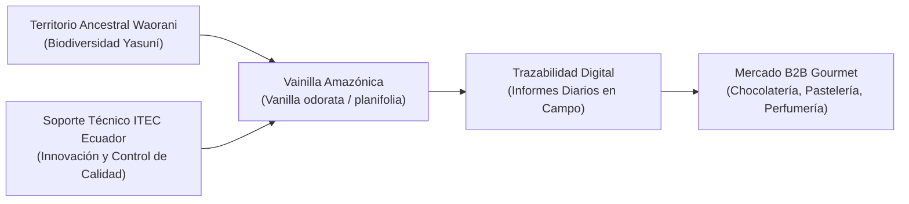
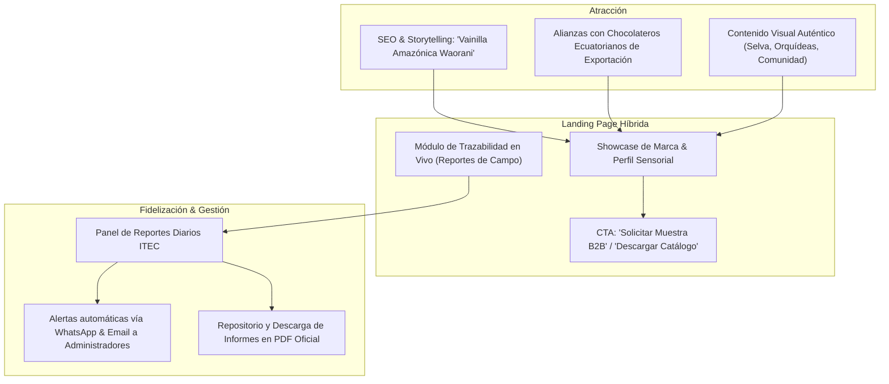

# 🌿 Amazon Vanilla By Waorani People & ITEC Ecuador
## Estudio Integral de Mercado, Estrategia de Marketing & Arquitectura de Landing Page

---

## 1. Resumen Ejecutivo y Propuesta de Valor Única (UVP)

El proyecto **Amazon Vanilla By Waorani People**, desarrollado en alianza técnica con **ITEC Ecuador** (*Innovación para un campo sostenible*), representa una oportunidad de bioeconomía regenerativa de alto impacto en el mercado global de ingredientes gourmet y cosméticos.

### Propuesta de Valor Única (UVP)
> **"La orquídea sagrada que custodia la Amazonía: Vainilla silvestre y agroforestal de terroir Waorani, con trazabilidad agronómica digital punto a punto y comercio justo directo que preserva la mayor biodiversidad del planeta."**

---

## 2. Investigación del Mercado Global y Local (2025 – 2026)

### 2.1 Tamaño del Mercado y Tendencias Globales
* **Valor del Mercado Total de Vainilla:** Proyectado en **$4.11 mil millones de USD para 2026**, con una tasa de crecimiento anual compuesta (CAGR) del 5.8% al 6.2%.
* **Nicho de Vainilla Natural Sostenible:** Valorado en **$1.7 mil millones de USD**, con un crecimiento del **10.1% anual**, impulsado por regulaciones internacionales de *Clean Label* y el rechazo a la vainillina química artificial.
* **Dominio del Canal B2B:** Más del **72%** de las compras mundiales de vainilla natural se realizan a nivel B2B (alta chocolatería, gastronomía dulce, casas de aromas y cosmética orgánica).
* **Vulnerabilidad de Madagascar:** Madagascar concentra cerca del 70% de la producción mundial, lo que genera alta volatilidad de precios por ciclones y sequías. La industria internacional busca activamente **orígenes alternativos sostenibles en América Latina**.

### 2.2 Estructura de Precios (Referencia de Mercado)

| Eslabón de la Cadena | Tipo de Producto / Estado | Rango de Precio Estimado (USD) | Mercado / Destino |
| :--- | :--- | :--- | :--- |
| **Mercado Spot Internacional** | Vaina curada Grado Gourmet (Negra, flexible) | **$400 – $500+ / kg** | Importadores gourmet Europa / EE.UU. |
| **Exportación FOB Ecuador** | Vaina acondicionada de exportación | **$70 – $110 / kg** | Mayoristas e industrias chocolateras |
| **Comercio Justo en Campo** | Vaina fresca / pre-curada en comunidad | **$35 – $60 / kg** | Pago digno a familias recolectoras Waorani |
| **Retail Gourmet / Fraccionado** | Tubo con 2–3 vainas (10g – 15g) o polvo fino | **$8 – $16 por unidad** | Pastelerías premium, tiendas bio, canal directo |

---

## 3. Ventajas Competitivas de Amazon Vanilla

1. **Genética Autóctona y Perfil Organoléptico Único:**
   * Presencia de especies nativas como *Vanilla odorata* y ecotipos amazónicos adaptados al bosque húmedo tropical, con notas anisadas, florales, amaderadas y a miel de selva, inimitables por la vainilla Bourbon convencional.
2. **Sinergia Natural con el Cacao Fino de Aroma de Ecuador:**
   * Ecuador es el exportador número 1 de cacao fino de aroma del mundo. Los mejores chocolateros *Bean-to-Bar* (Pacari, República del Cacao, chocolateros artesanales en Suiza, Francia y EE.UU.) buscan vainilla natural auténtica de origen ecuatoriano para maridar con sus barras prémium.
3. **Storytelling de Conservación Biocultural Irresistible:**
   * Cada compra de vainilla financia directamente la soberanía territorial del pueblo Waorani y desincentiva la tala ilegal y la expansión petrolera en la Amazonía ecuatoriana.
4. **Innovación y Rigor Agronómico (ITEC Ecuador):**
   * A diferencia de iniciativas informales, ITEC estandariza la polinización manual, el manejo orgánico de tutores y el monitoreo diario sistematizado, garantizando a los compradores consistencia en calidad, humedad y contenido de vanillina.

---

## 4. Segmentación de Clientes (Buyer Personas)

### Perfil 1: "El Maestro Chocolatero & Chef Pastelero de Especialidad" (B2B Gourmet)
* **Ubicación:** Zonas metropolitanas (Quito, Guayaquil, París, Nueva York, Tokio, Barcelona).
* **Motivación:** Exclusividad organoléptica, vainas con alto brillo y abundante caviat (semillas), diferenciación en carta de postres y barras de chocolate *single-origin*.
* **Qué busca en la web:** Ficha técnica de calidad, porcentaje de vanillina, perfil aromático y botón para ordenar muestras comerciales.

### Perfil 2: "El Director de Sourcing Sostenible / ESG" (B2B Industrial & Cosmética)
* **Ubicación:** Empresas europeas y norteamericanas de ingredientes botánicos y cosmética natural.
* **Motivación:** Cumplimiento de normativas de no deforestación, trazabilidad comprobable y cadena de suministro libre de trabajo infantil.
* **Qué busca en la web:** Verificación de informes diarios en campo, fotografías reales del cultivo, métricas de impacto comunitario Waorani.

### Perfil 3: "Organismos de Cooperación & Fondos de Bioeconomía"
* **Ubicación:** Cooperación internacional (GIZ, USAID, PNUD, fundaciones de conservación).
* **Motivación:** Inversión de impacto en proyectos escalables que protejan la biodiversidad amazónica.
* **Qué busca en la web:** Transparencia de datos, rigor metodológico de ITEC Ecuador y reportes de progreso descargables.

---

## 5. Estrategia de Marketing y Comunicación Digital

### Pilares de Contenido y Narrativa:
1. **"De la Flor a la Vaina":** Divulgar el proceso meticuloso de polinización manual flor por flor en el dosel de la selva.
2. **"Trazabilidad Abierta":** Mostrar cómo la tecnología de ITEC registra en tiempo real las condiciones de cultivo (temperatura, lluvia, salud fitosanitaria).
3. **"Tradición que Genera Futuro":** Poner en el centro a las familias Waorani como guardianes y socios del proyecto.

---

## 6. Arquitectura Estructural de la Landing Page

La solución web resolverá dos objetivos en una sola plataforma:

### Área Pública (Para Compradores, Inversionistas y Visitantes)
1. **Header:**
   * Logo oficial *Amazon Vanilla By Waorani People* & respaldo de *ITEC Ecuador*.
   * Navegación fluida: Origen | Perfil Aromático | Proceso ITEC | Trazabilidad | Contacto / Muestras.
   * Botón de acceso administrativo discreto (`Acceso Campo / ITEC`).
2. **Hero Section:**
   * Gran impacto visual con fotografía inmersiva de la flor de vainilla en territorio amazónico.
   * Mensaje claro: *"Vainilla pura de la Amazonía ecuatoriana: Tradición Waorani e Innovación Sostenible"*.
   * Doble botón de acción: `Solicitar Muestra B2B` y `Ver Informes de Cultivo`.
3. **El Origen Waorani:**
   * Territorio, cultura y preservación del bosque frente al extractivismo.
4. **El Rigor de ITEC Ecuador:**
   * Metodología técnica, manejo agronómico limpio y estándares de exportación.
5. **Notas de Cata & Ficha Técnica:**
   * Especificaciones de la vaina (longitud, contenido de humedad 30-35%, porcentaje de vanillina, aroma).
6. **Ventana Pública de Trazabilidad:**
   * Muestra interactiva de los últimos lotes y reportes de campo registrados.
7. **Formulario de Contacto Comercial / Pedidos B2B:**
   * Captura de prospectos calificados para cotizaciones y envío de muestras.

### Área Operativa & Administrativa (Para Técnicos de Campo y Dirección)
1. **Formulario Diario Digital (Móvil / Tablet Friendly):**
   * Réplica exacta e intuitiva de la hoja física de ITEC:
     * Condiciones del día (Fecha, Lote, Responsable, Temp Mín/Máx, Humedad, Clima en botones).
     * 10 Actividades con checks rápidos.
     * 10 Herramientas con checks rápidos.
     * Insumos aplicados (tabla dinámica).
     * Estado del cultivo (semáforo táctil Bueno / Regular / Malo).
     * Observaciones y subida de 3 fotografías georreferenciadas.
2. **Repositorio de Informes Diarios:**
   * Listado en vivo ordenado por fecha de envío.
   * Botón de descarga individual en **PDF idéntico al formato oficial** y exportación global a **Excel**.
   * Filtros por lote, rango de fechas y estado fitosanitario.
3. **Alertas Instantáneas:**
   * Disparo automático de resumen a **WhatsApp** del administrador y copia por **Correo Electrónico**.
4. **Panel de Gestión de Administrador:**
   * Capacidad de editar el catálogo de actividades y herramientas.
   * Corrección o eliminación controlada de reportes y fotografías.
